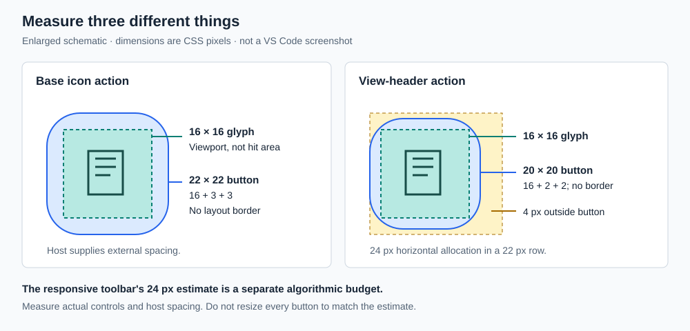
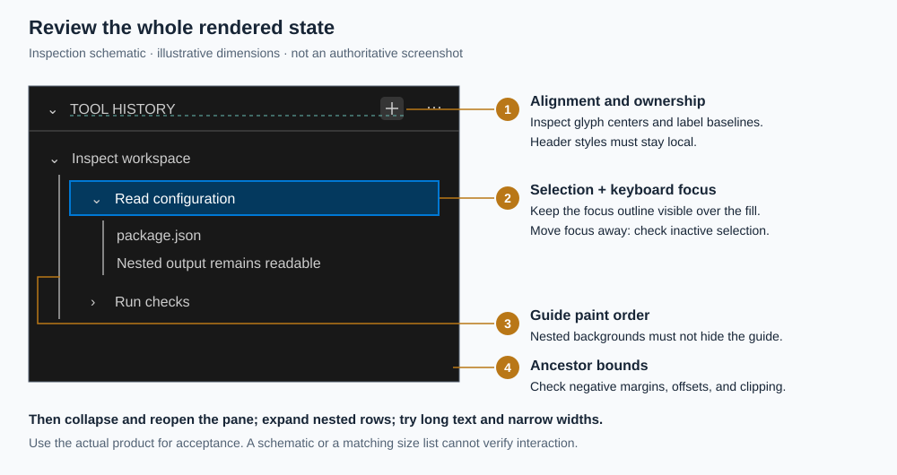

# Applying the references to a product

This is an adaptation and acceptance workflow. Its examples are decisions for
existing products, not additional claims about VS Code's component defaults.

## Component mapping

Before editing styles, inspect the rendered hierarchy and the components that
own behavior. For each affected component, record its purpose, closest reference,
variant, relevant states, and any uncovered detail. A short working list suffices:

- **Sidebar collapse command → icon action in a view header.** Map its glyph,
  button box, and focus treatment. Keep sidebar visibility on the sidebar owner;
  changing this command must not restyle all sidebar buttons or hidden content.
- **Model picker → labeled choice control.** Preserve the selected value,
  popup, keyboard behavior, and label space. A toolbar parent does not establish
  the compact `11px` variant. A richer model picker without a reliable match is
  partially covered: use supported choice/theme rules and retain its layout.
- **Assistant reply → readable Markdown content.** Map prose, code, disclosures,
  and message actions separately. A copy button's metrics do not set body type.
- **Nested tool history → disclosure/list composition.** Identify who draws
  indentation guides, row backgrounds, and focus. A content wrapper must not
  obscure guides owned by an ancestor.
- **Custom visualization → uncovered content.** Retain its interaction and
  layout. Apply a host surface role only when the containing region is mapped;
  do not invent a Classic chart contract.

Map the whole affected surface before changing one component family, then apply
each mapped family consistently across its states. This avoids arbitrary islands
of new styling. Uncovered does not mean exempt from checking alignment, clipping,
or regressions at its boundary with covered components.

In ordinary adaptation, choose reasonable mappings yourself and preserve product
functionality. Do not repeatedly ask the user to arbitrate font sizes or CSS
mechanisms. For a requested exact replica, use source and rendered evidence from
the target version, platform, theme, and settings. If a fact cannot be verified,
identify the gap instead of silently substituting a neighboring component rule.

## Measurement contract

All measurements are CSS pixels at the stated zoom. For every mapped component,
distinguish these quantities in implementation notes or inspection:

- **Graphic viewport:** icon/SVG box, independent of the glyph's painted bounds.
  Text uses its font size and line box; font size is not button height.
- **Control border box:** rendered width × height, including internal padding
  and border. Record both axes, or say content-sized/minimum/max-constrained.
- **Hit target:** usually the interactive border box. If a host expands it,
  record that separately and verify it does not intercept adjacent controls.
- **External spacing:** margins and parent gaps outside the control. State which
  owner supplies them. A layout slot can include these without making them clickable.
- **Border accounting:** a `1px` border occupies each applicable side; an
  outline or overlay marker does not change layout. Do not add border width again
  to a dimension already measured as a border box.

Unless a reference labels a dimension as content, glyph, minimum, or allocation,
interpret a control's size as its outer border box. This describes the intended
rendered result, not a mandate for a global `box-sizing` reset. When translating
source CSS, account for its actual box model. Unspecified external spacing is
owned by the host; retain it in adaptation rather than inventing a global gap.

| Component / variant | Graphic | Control border box | External spacing / allocation | Border accounting |
| --- | --- | --- | --- | --- |
| Base icon action | 16 × 16 | 22 × 22 | Host-owned; responsive 24 px estimate is separate | 3 px padding per side, no layout border |
| View-header icon action | 16 × 16 | 20 × 20 in a 22 px row | 4 px trailing margin; 24 px allocation | 2 px padding per side, no layout border |
| Find option toggle | 16 × 16 | 20 × 20 | 2 px leading margin; 22 px allocation | Includes 1 px padding and 1 px border per side |
| Default text button | Text line 16 px high | Content width × 26 px | Button-bar owned | Includes 4 px vertical padding and 1 px border per side |
| Compact activity item | 16 × 16 | 36 × 28 | No gap | Marker inside box; no extra width |

This enlarged schematic separates graphic, clickable box, and outside space.
It is not a screenshot or a new rule for all toolbars.

## Scope styles and implementation choices

Required outcomes are appearance, interaction, resizing, and state behavior.
Grid nesting, mirror elements, measuring scripts, and DOM wrappers are optional
implementation techniques unless required by the product's own architecture.
Keep an existing implementation that already produces the intended result.

Scope selectors to the mapped component and variant. Avoid generic descendant
rules such as `.sidebar button` or `.toolbar *` for dimensions and font sizes.
Trace inherited `font-size`, `line-height`, padding, transforms, positioning,
negative margins, and overflow through ancestors before adding a local offset.
Fix the owning rule instead of compensating with unexplained translations.

## Visual acceptance

Inspect the running product at its normal zoom and a constrained width, using
realistic content. Take representative screenshots in supported light and dark
themes. Add high contrast when supported or requested. Check the following:

1. **Computed geometry:** inspect bounding rectangles and computed padding,
   borders, margins, gaps, font metrics, and box sizing. Compare the glyph,
   clickable box, and allocated slot separately; include native button defaults.
2. **Alignment:** inspect icon centering and the baseline of adjacent text,
   selector values, and action labels. A centered SVG viewport can still contain
   an off-center path; fix the cause before introducing an optical adjustment.
3. **Ancestors and painting:** inspect parent negative margins, transforms,
   positioned offsets, scroll containers, clipping, and stacking. Confirm that
   nested row fills do not cover indentation guides, focus rings, or separators.
4. **Transitions:** exercise collapse/expand, hide/show, resizing, and nested
   disclosures. Verify restored widths, arrow state, retained focus, absence of
   invisible hit targets, and unchanged behavior in adjacent components.
5. **Combined states:** inspect hover with selection, keyboard focus with
   selection, inactive selection after focus leaves, disabled actions, and open
   popups. Focus must remain visible; a selection fill must not erase its outline.
6. **Content pressure:** use long localized labels, CJK, a long unbroken path,
   multiline prose, nested lists, wide code, and an enlarged body preference.
   Check truncation, wrapping, toolbar overflow, scroll ownership, and popup edges.
   For Chat, also inspect streaming, stopped/error output, and disclosure expansion.
7. **Whole composition:** review the actual screenshots for readable hierarchy,
   consistent density, clear ownership, and balanced alignment. Correct numbers
   do not prove that the rendered composition works.

This schematic marks inspection targets, not authoritative screenshot geometry.
Use it to locate checks on the actual product; do not reproduce its illustrative
row dimensions or labels as a new component specification.

Record what was observed, what was corrected, and which states remain unverified.
If execution or screenshot access is unavailable, report that limitation. Never
claim visual acceptance from source inspection, lint, or these diagrams alone.
